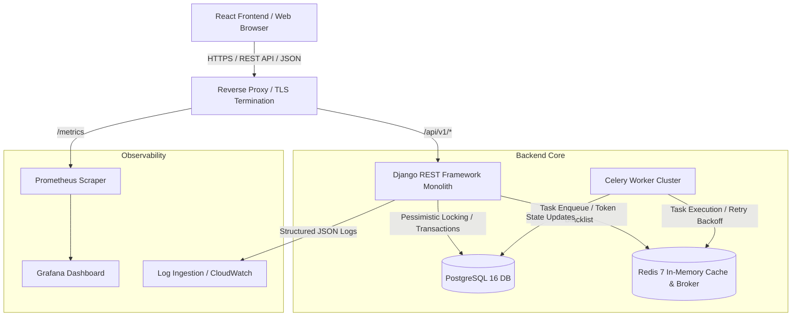
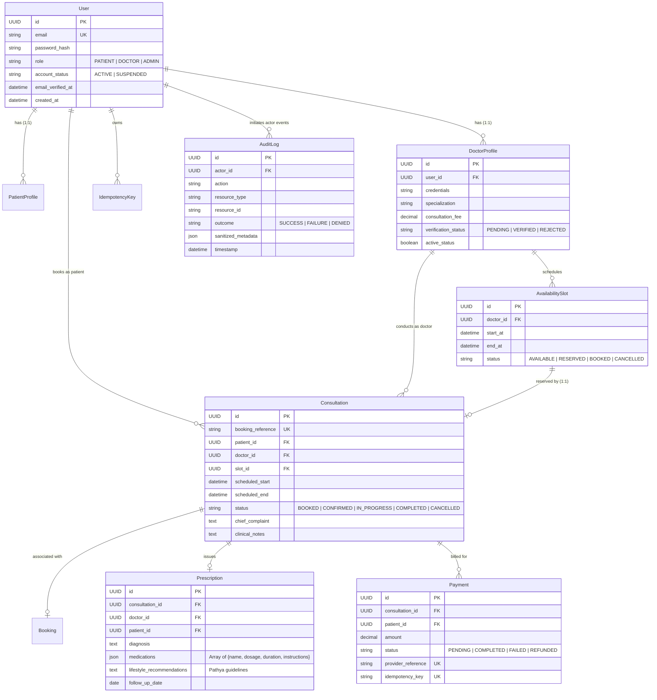

# Amrutam Telemedicine Platform: System Architecture & Engineering Blueprint

## Executive Overview
The **Amrutam Telemedicine Platform** is an enterprise-grade, transaction-safe clinical application designed to deliver authentic Ayurvedic healthcare at scale. Engineered to support **100,000 daily consultations**, the platform employs a decoupled modular monolith architecture with Python/Django REST Framework on the backend, PostgreSQL for relational consistency and row-level locking, Redis & Celery for asynchronous background tasks, and a modern React (JavaScript, Vite, Tailwind CSS) frontend.

---

## 1. High-Level Architecture Diagram



---

## 2. Component Responsibilities & Domain Separation

| Domain Component | Primary Technology | Responsibility |
| :--- | :--- | :--- |
| **Frontend Application** | React 18, Vite, Tailwind CSS, Lucide, Recharts | Interactive patient discovery, real-time availability slot selection, doctor consultation workspace, admin Recharts analytics. |
| **API Gateway / Core** | Django 5.0, DRF, Whitenoise, Gunicorn | Request routing, JWT verification, RBAC permissions, Request-ID tracing, and structured JSON error formatting. |
| **Concurrency & Idempotency** | Django ORM, PostgreSQL `select_for_update` | Atomically locks slot rows, calculates SHA-256 request payload fingerprints, and guarantees single-claim semantics. |
| **Persistence Layer** | PostgreSQL 16 (or SQLite in local non-daemon dev) | ACID relational storage, check constraints, foreign key cascades, and append-only audit trail immutability. |
| **Async Worker Queue** | Celery 5.4 + Redis 7 | Expired idempotency cleanup, background notification dispatch, and telemetry aggregation. |

---

## 3. Entity-Relationship (ER) Diagram



---

## 4. Transaction-Safe Booking Sequence & Concurrency Control

```mermaid
sequenceDiagram
    autonumber
    actor Patient
    participant Frontend as React Client
    participant API as Django REST API
    participant Lock as PostgreSQL (select_for_update)
    participant DB as Relational Database
    participant Audit as Append-Only Audit

    Patient->>Frontend: Select Doctor Slot & Enter Symptoms
    Frontend->>Frontend: Generate unique UUID Idempotency-Key
    Frontend->>API: POST /api/v1/bookings [Header: Idempotency-Key: K1]
    
    API->>DB: Check IdempotencyKey(key=K1, user=Patient)
    alt Key already COMPLETED with same payload
        DB-->>API: Return cached JSON response
        API-->>Frontend: 200 OK (Cached Consultation Reference)
    else Key exists with DIFFERENT payload
        API-->>Frontend: 422 Unprocessable Entity (Idempotency Mismatch)
    else Fresh Key
        API->>DB: Create IdempotencyKey (status=PROCESSING)
        API->>Lock: BEGIN TRANSACTION; SELECT * FROM AvailabilitySlot WHERE id=S1 FOR UPDATE;
        alt Slot.status != 'AVAILABLE'
            Lock-->>API: Slot already BOOKED / RESERVED
            API->>DB: Update IdempotencyKey(status=FAILED)
            API-->>Frontend: 409 Conflict (Slot already claimed by competing transaction)
        else Slot is AVAILABLE
            API->>DB: UPDATE AvailabilitySlot SET status='BOOKED'
            API->>DB: INSERT INTO Consultation (status='BOOKED', ref='AMR-...')
            API->>DB: INSERT INTO Payment (status='PENDING', amount=Fee)
            API->>Audit: Record BOOKING_CREATED (Sanitized Metadata)
            API->>DB: Update IdempotencyKey(status='COMPLETED', response_body={...})
            API->>Lock: COMMIT TRANSACTION;
            API-->>Frontend: 201 Created (Booking Details & Reference)
        end
    end
```

---

## 5. Scaling Plan for 100,000 Daily Consultations

### Quantitative Sizing
- **Daily Volume**: 100,000 consultations per 24-hour cycle (~1.16 bookings/sec average; peak 10–15 bookings/sec during 10:00–14:00 peak hours).
- **Read Traffic**: Typically 15x–20x write traffic (~150–300 requests/sec for doctor searches, slot lookups, and profile queries).
- **Data Growth**: ~100k consultations + payments + audit events daily = ~150 MB relational storage daily (~55 GB annually).

### Scalability Strategy
1. **Connection Pooling**: Deploy **PgBouncer** in transaction pooling mode between Gunicorn instances and PostgreSQL to support thousands of concurrent client connections with minimal connection overhead.
2. **Read/Write Splitting**: Implement Django database routing to direct doctor directory queries (`GET /api/v1/doctors`) and public availability views to PostgreSQL Read Replicas, leaving the Primary Writer dedicated to transactional booking and consultation state transitions.
3. **Redis Caching**: Cache verified doctor public profile cards and doctor specialization metadata in Redis with 15-minute TTLs. Automatically invalidate cache entries when doctors update their profile.
4. **Table Partitioning**: Implement range partitioning by `scheduled_start` date on the `Consultation` and `AuditLog` tables (e.g. monthly partitions), allowing high-velocity inserts and fast sequential vacuuming.
5. **Horizontal Web Scaling**: Run stateless Gunicorn/Django container instances behind AWS ALB or Kubernetes Horizontal Pod Autoscaler (HPA) targeting 70% CPU utilization.
