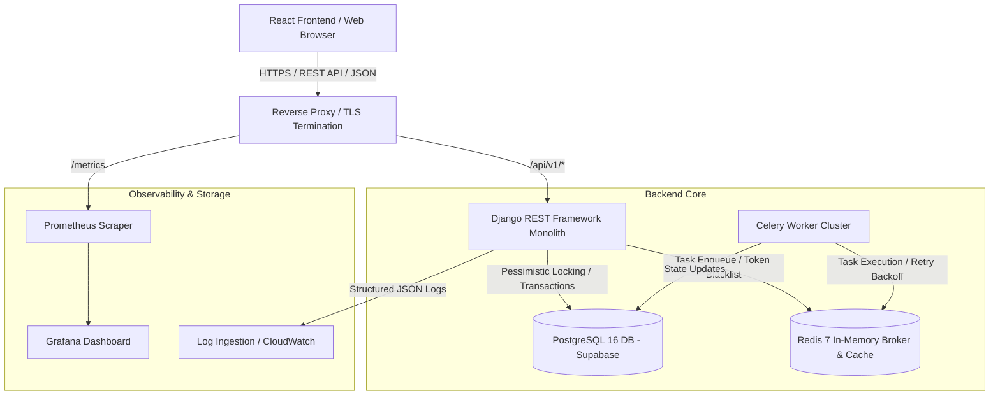
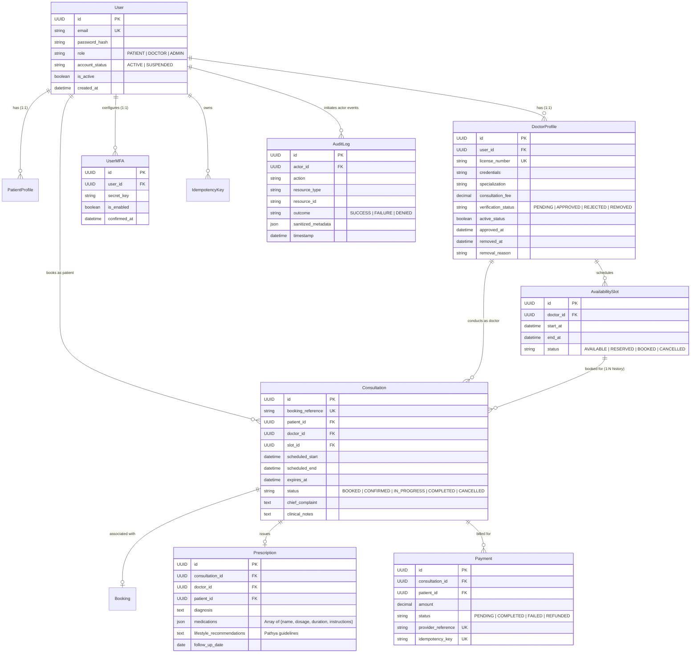

# Amrutam Telemedicine Platform: System Architecture & Engineering Blueprint

## Executive Overview
The **Amrutam Telemedicine Platform** is an enterprise-grade, transaction-safe clinical healthcare system engineered to deliver authentic Ayurvedic consultations at scale. Engineered to support **100,000 daily consultations**, the platform features a decoupled modular monolith backend in Python/Django REST Framework, PostgreSQL with pessimistic concurrency control, Redis & Celery for asynchronous background jobs, structured JSON logging, and a responsive React (JavaScript, Vite, Tailwind CSS) frontend.

---

## 1. High-Level Architecture & System Data Flow



### Data Flow Lifecycle
1. **Client Interaction**: The patient or doctor interacts with the responsive React single-page application.
2. **Gateway & Routing**: Requests pass through reverse proxy/TLS termination to the Django REST Framework application.
3. **Authentication & Authorization**: Requests are authenticated via JWT access tokens. Role-based permissions (`IsPatient`, `IsDoctor`, `IsAdminUserRole`) and TOTP MFA are enforced.
4. **Business Logic & Service Layer**: Views delegate to modular domain services (`BookingService`, `DoctorService`, `PaymentService`).
5. **Persistence & Locking**: Transactions execute inside `transaction.atomic()` blocks, acquiring exclusive row locks (`select_for_update`) on slot records.
6. **Background Tasks**: Heavy or scheduled jobs (e.g. releasing expired 10-minute slot holds) are processed by Celery workers via Redis.
7. **Audit & Observability**: Every mutating action writes an append-only `AuditLog` entry; Prometheus scrapes runtime metrics from `/metrics`.

---

## 2. Component Responsibilities & Domain Separation

| Domain Component | Primary Technology | Responsibility |
| :--- | :--- | :--- |
| **Frontend Application** | React 18, Vite, Tailwind CSS, Lucide, Recharts | Interactive doctor discovery, real-time availability slot selection, doctor consultation workspace, admin Recharts analytics. |
| **API Gateway / Core** | Django 5.0, DRF, Whitenoise, Gunicorn | Request routing, JWT verification, RBAC permissions, Request-ID tracing, and structured JSON error formatting. |
| **Concurrency & Idempotency** | Django ORM, PostgreSQL `select_for_update` | Atomically locks slot rows, calculates SHA-256 request payload fingerprints, and guarantees single-claim semantics. |
| **Persistence Layer** | PostgreSQL 16 (hosted on Supabase) | ACID relational storage, check constraints, foreign key cascades, partial unique indexes, and append-only audit trail immutability. |
| **Async Worker Queue** | Celery 5.4 + Redis 7 | Expired reservation cleanup, background notification dispatch, and telemetry aggregation. |

---

## 3. Entity-Relationship (ER) Diagram



---

## 4. API Design & Interface Contracts

The API follows strict RESTful conventions under the versioned prefix `/api/v1/`:

* **Standard Envelope**: Successful write operations return `{ "success": true, "message": "...", "data": { ... } }`.
* **Standard Error Representation**: Errors return RFC 7807-compliant payloads:
  ```json
  {
    "success": false,
    "error": {
      "code": "SLOT_UNAVAILABLE",
      "message": "Sorry, this time slot has just been booked. Please select another available time."
    }
  }
  ```
* **HTTP Status Code Mapping**:
  * `200 OK`: Successful read or idempotent cached completion.
  * `201 Created`: Resource successfully created (booking, availability slot, user).
  * `400 Bad Request`: Payload validation error or invalid business transition.
  * `401 Unauthorized`: Missing, expired, or invalid JWT token.
  * `403 Forbidden`: Permission denied (cross-tenant access or role violation).
  * `404 Not Found`: Target entity does not exist.
  * `409 Conflict`: Slot concurrency collision or double-booking attempt.
  * `422 Unprocessable Entity`: Idempotency key mismatch (same key with different payload).
* **OpenAPI Documentation**: Automatically generated via `drf-spectacular` at `/api/schema/` and rendered interactively via Swagger UI at `/api/docs/`.

---

## 5. Transaction & Concurrency Strategy

```mermaid
sequenceDiagram
    autonumber
    actor PatientA as Patient A
    actor PatientB as Patient B
    participant API as Django REST API
    participant Lock as PostgreSQL (select_for_update)
    participant DB as Supabase PostgreSQL

    Note over PatientA,PatientB: Both click "Book 10:30 PM Slot" at the same millisecond
    PatientA->>API: POST /api/v1/bookings {slot_id: S1} [Idempotency-Key: K1]
    PatientB->>API: POST /api/v1/bookings {slot_id: S1} [Idempotency-Key: K2]
    
    rect rgb(240, 255, 240)
        Note over API,DB: Transaction A starts (Thread 1)
        API->>Lock: BEGIN; SELECT * FROM AvailabilitySlot WHERE id=S1 FOR UPDATE;
        Lock-->>API: Row Locked (Acquired by Transaction A)
    end

    rect rgb(255, 240, 240)
        Note over API,DB: Transaction B waits for row lock (Thread 2)
        API->>Lock: BEGIN; SELECT * FROM AvailabilitySlot WHERE id=S1 FOR UPDATE;
    end

    API->>DB: Check slot status == 'AVAILABLE' -> TRUE
    API->>DB: UPDATE AvailabilitySlot SET status='RESERVED'
    API->>DB: INSERT INTO Consultation (status='BOOKED', expires_at=NOW+10min)
    API->>DB: INSERT INTO Payment (status='PENDING')
    API->>DB: COMMIT; (Transaction A releases lock)
    API-->>PatientA: 201 Created (10-Minute Reservation Confirmed)

    rect rgb(255, 240, 240)
        Lock-->>API: Row Lock Granted to Transaction B
        API->>DB: Re-read slot status -> 'RESERVED' != 'AVAILABLE'
        API->>DB: ROLLBACK;
        API-->>PatientB: 409 Conflict ("Sorry, this time slot has just been booked...")
    end
```

### Concurrency Mechanisms
1. **Pessimistic Row-Level Locking (`select_for_update`)**: Acquires an exclusive lock on the specific `AvailabilitySlot` row inside a `transaction.atomic()` block. Competing requests block until the first transaction commits or rolls back.
2. **Partial Unique PostgreSQL Constraints**:
   * `unique_active_consultation_per_slot`: Enforces unique `slot` WHERE `status IN ('BOOKED', 'CONFIRMED', 'IN_PROGRESS')`.
   * `unique_active_doctor_appointment_time`: Enforces unique `(doctor, scheduled_start)` WHERE `status IN ('BOOKED', 'CONFIRMED', 'IN_PROGRESS')`.
   * Cancelled and completed appointments are excluded from the index, allowing released slots to be safely re-booked while preserving complete clinical history.
3. **10-Minute Hold Reservation Window**: Upon booking, `expires_at = now + timedelta(minutes=10)`. If payment is not completed within 10 minutes, the slot is dynamically treated as available and released for other patients without database record deletion.

---

## 6. Retry and Backoff Strategies

1. **Frontend HTTP Client (Axios)**:
   * Automatic 401 token refresh queue in [`frontend/src/api/axios.js`](../frontend/src/api/axios.js#L44). When an access token expires, outgoing requests pause in a FIFO queue while a single refresh request runs. Once the token is rotated, all queued requests replay with the fresh token.
   * If refresh fails (session revoked), the queue rejects, clearing session storage and redirecting to login.
2. **Asynchronous Task Retries (Celery)**:
   * Background tasks (e.g. reservation release, notification dispatch) configure automatic retry with exponential backoff:
     ```python
     @shared_task(bind=True, max_retries=5, default_retry_delay=60, retry_backoff=True, retry_backoff_max=600)
     def release_expired_reservations_task(self):
         ...
     ```
   * Exponential backoff formula: $T_{retry} = \text{delay} \times 2^{\text{attempt}}$, bounded at 10 minutes, preventing thundering herds against the database.
3. **Database Connection Resilience**:
   * Django configured with `CONN_MAX_AGE = 600` and Supabase connection pooler support (`aws-0-ap-northeast-2.pooler.supabase.com`), handling transient network resets gracefully.

---

## 7. Caching and Data Partitioning Decisions

### Caching Strategy
* **Session & Task Broker**: Redis 7 stores Celery job queues and SimpleJWT token blacklist.
* **Read-Heavy Public Directory**: Doctor profile cards and specialties are read ~20x more frequently than bookings. Future production configuration caches `GET /api/v1/doctors` responses in Redis with a 15-minute TTL, invalidated when doctors update their profile.
* **Why Slots Are NOT Cached in Redis**: To maintain strict ACID consistency and avoid stale slot reads, slot availability is queried directly from PostgreSQL with pessimistic row locks. Caching active availability in Redis risks distributed cache invalidation race conditions.

### Data Partitioning Strategy
* **Growth Profile**: At 100,000 consultations per day, `Consultation`, `Payment`, and `AuditLog` accumulate ~36.5 million rows annually (~55 GB/year).
* **Partitioning Implementation**:
  * Range partitioning by `scheduled_start` month on `Consultation`:
    ```sql
    CREATE TABLE consultations_y2026m10 PARTITION OF consultations
        FOR VALUES FROM ('2026-10-01') TO ('2026-11-01');
    ```
  * Range partitioning by `timestamp` month on `AuditLog`.
  * Benefits: High-velocity partition pruning on date-filtered queries and instant archival of historical partitions via tablespace detachment.

---

## 8. Backup and Disaster Recovery Strategy

| Objective | Target | Implementation Mechanism |
| :--- | :--- | :--- |
| **Recovery Point Objective (RPO)** | **< 15 minutes** | Continuous PostgreSQL Write-Ahead Log (WAL) archiving to encrypted cloud object storage (Amazon S3 / Supabase storage). |
| **Recovery Time Objective (RTO)** | **< 1 hour** | Automated container redeployment via Docker Compose or Kubernetes manifests, connecting to restored snapshot. |
| **Automated Daily Backups** | **24-hour cycle** | Full automated daily database snapshot retained for 30 days with multi-region replication. |
| **Point-In-Time Recovery (PITR)** | **Up to 7 days** | WAL replay enables restoring the database to any exact second within the retention window. |
| **Data Integrity Verification** | **Weekly** | Automated backup restoration test into an isolated staging database verifying table row counts and checksums. |

---

## 9. Scalability Assumptions & Quantitative Model (100,000 Daily Consultations)

### Workload Sizing Breakdown
* **Daily Consultations**: 100,000 appointments per 24 hours.
* **Average Booking Rate**: $\frac{100,000}{86,400} \approx 1.16$ bookings/second.
* **Peak Booking Rate (10:00–14:00 window)**: $4\times$ average $\approx 10\text{--}15$ write requests/second.
* **Read-to-Write Ratio**: Estimated at $15:1$ (browsing doctors, checking slots, reviewing prescriptions).
* **Peak Read Throughput**: $15 \times 15 = 225$ read queries/second.

### Infrastructure Sizing Requirements
1. **Application Tier**: 3 stateless Gunicorn/Django container instances (2 vCPU, 4 GB RAM each) behind an application load balancer, comfortably handling 300+ requests/second.
2. **Database Tier**: Managed PostgreSQL 16 (4 vCPU, 16 GB RAM, 2,000 IOPS SSD) with PgBouncer connection pooling set to 100 client connections.
3. **Read Replicas**: Deploy 2 PostgreSQL Read Replicas for `GET /api/v1/doctors` and admin analytics queries, keeping the primary writer isolated for booking transactions.
4. **Network Bandwidth**: ~25 KB average response payload $\times$ 250 req/s $\approx$ 6.25 MB/s network throughput at peak.
