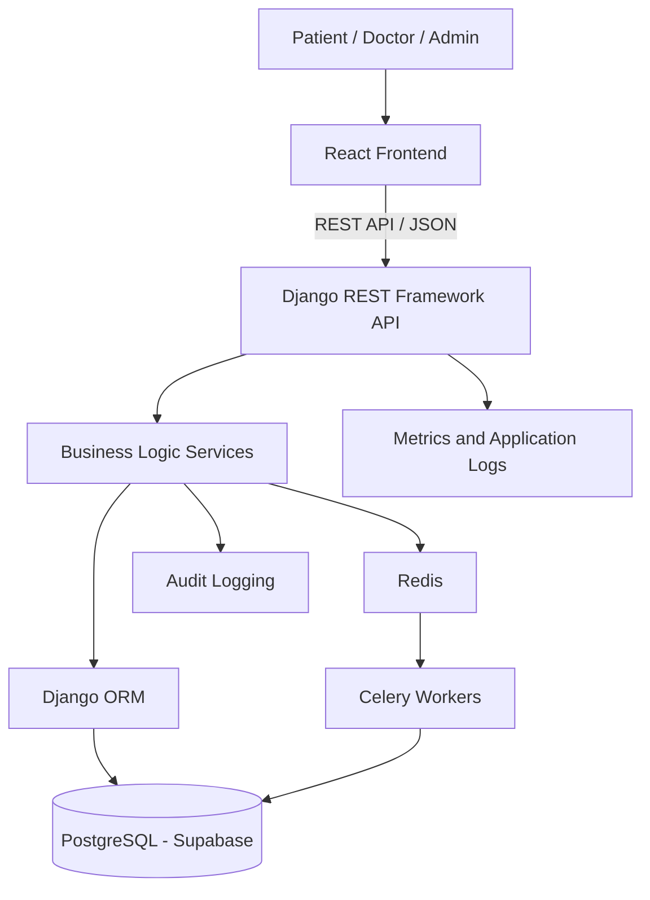
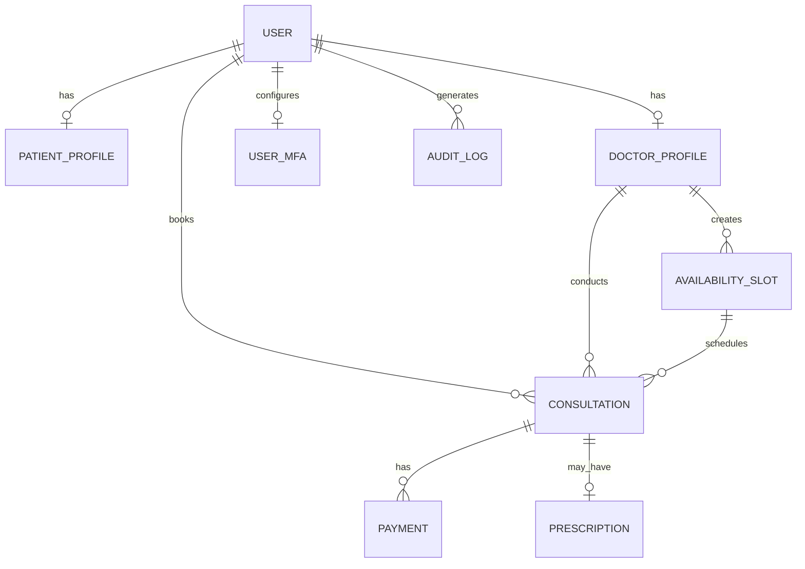

# Amrutam Telemedicine Platform

## System Architecture

## 1. Overview

Amrutam Telemedicine is a web application that connects patients with Ayurvedic doctors. Patients can search for doctors, book appointments, make simulated payments, and view prescriptions. Doctors can manage appointments and issue prescriptions, while administrators manage doctor approvals and monitor platform activity.

The application follows a **three-layer architecture**:

1. **Presentation Layer:** React frontend for patients, doctors, and administrators.
2. **Business Logic Layer:** Django REST Framework APIs that handle authentication, booking, payments, consultations, and permissions.
3. **Data Access Layer:** Django ORM and PostgreSQL for storing and retrieving application data.

The backend is organized as a modular monolith, with different Django applications responsible for specific business functions.

## 2. Technology Stack

| Component         | Technology                            | Purpose                                        |
| ----------------- | ------------------------------------- | ---------------------------------------------- |
| Frontend          | React, JavaScript, Vite, Tailwind CSS | User interface                                 |
| Backend           | Python, Django, Django REST Framework | APIs and business logic                        |
| Database          | PostgreSQL, Supabase                  | Persistent application data                    |
| Authentication    | JWT and TOTP MFA                      | Secure user authentication                     |
| Background Tasks  | Celery and Redis                      | Asynchronous task processing, where configured |
| API Documentation | OpenAPI and Swagger UI                | API documentation                              |
| Testing           | Pytest and Vitest                     | Backend and frontend testing                   |
| Containerization  | Docker and Docker Compose             | Consistent application execution               |
| CI                | GitHub Actions                        | Automated checks                               |

## 3. High-Level Architecture



**Note:** This diagram represents the intended application architecture. Redis, Celery, metrics, and other infrastructure components should be considered operational only where their configuration and execution have been verified.

### Request Flow

1. A user interacts with the React frontend.
2. The frontend sends an API request to Django REST Framework.
3. The backend authenticates the request and checks the user's permissions.
4. Business logic validates the requested operation.
5. Django ORM reads or updates the PostgreSQL database.
6. The backend returns the response to the frontend.
7. Relevant operations are recorded in audit logs.

## 4. Main Components

### Frontend

The React frontend provides separate interfaces for patients, doctors, and administrators.

Its main responsibilities include:

* User registration and login.
* Doctor search and availability display.
* Appointment booking and cancellation.
* Payment interaction.
* Consultation and prescription views.
* Administrative dashboards and analytics.

### Backend

The Django REST Framework backend manages application functionality.

Its main modules include:

| Module        | Responsibility                                        |
| ------------- | ----------------------------------------------------- |
| Accounts      | Users, authentication, JWT, and MFA                   |
| Doctors       | Doctor profiles, approval, and verification           |
| Availability  | Doctor availability and appointment slots             |
| Bookings      | Appointment creation, cancellation, and booking rules |
| Consultations | Consultation status and clinical workflow             |
| Prescriptions | Digital prescriptions and instructions                |
| Payments      | Payment status and simulated payment processing       |
| Audit         | Recording important application events                |
| Analytics     | Administrative reports and statistics                 |

### Database

PostgreSQL stores user accounts, doctor profiles, availability slots, consultations, prescriptions, payments, and audit records.

Django ORM provides database access, while database transactions and appropriate constraints help maintain data integrity.

## 5. Database Relationships

The main entities and their relationships are illustrated below.



The diagram shows the main logical relationships. The actual database schema and relationship cardinalities should be verified against the current Django models.

### Important Data

* **User:** Email, password hash, role, and account status.
* **Doctor Profile:** Specialization, consultation fee, and approval status.
* **Availability Slot:** Doctor, start time, end time, and availability status.
* **Consultation:** Patient, doctor, appointment slot, status, and clinical information.
* **Payment:** Consultation, amount, and payment status.
* **Prescription:** Diagnosis, medication details, dosage, and instructions.
* **Audit Log:** Actor, action, affected resource, timestamp, and sanitized metadata.

## 6. API Design

The application exposes REST APIs through Django REST Framework.

The configured API base path is:

`/api/v1/`

The OpenAPI schema and Swagger documentation are available at the following paths when the backend is running:

* **Swagger UI:** `/api/docs/`
* **OpenAPI schema:** `/api/schema/`

Important API operations include:

| Operation         | Purpose                            |
| ----------------- | ---------------------------------- |
| Authentication    | Register and authenticate users    |
| Doctor management | Search doctors and manage approval |
| Availability      | View and manage appointment slots  |
| Booking           | Create and cancel appointments     |
| Consultation      | Manage consultation status         |
| Prescription      | Create and retrieve prescriptions  |
| Payment           | Process simulated payments         |
| Analytics         | Display administrative statistics  |

Refer to the actual API routes and Swagger documentation for the complete endpoint list.

## 7. Appointment Booking and Concurrency

Preventing double-booking is an important requirement of the application.

The booking workflow is:

1. The patient selects an available doctor and time slot.
2. The frontend submits a booking request.
3. The backend validates the patient, doctor, slot, and booking rules.
4. A database transaction protects the booking operation.
5. The backend checks whether the slot is still available.
6. The appointment and associated payment record are created according to the booking workflow.
7. The frontend displays the booking result.

### Preventing Double-Booking

The backend can use Django's `transaction.atomic()` and PostgreSQL row-level locking through `select_for_update()` to coordinate competing booking requests.

Appropriate database constraints provide additional protection against duplicate active bookings.

If two patients attempt to reserve the same slot, only one booking should succeed. The other request should receive an appropriate conflict response.

Idempotency keys can also prevent duplicate bookings when a client retries the same request.

**Important:** The exact concurrency guarantees depend on the actual database configuration, constraints, and transaction implementation. They should be verified using concurrent requests against PostgreSQL.

## 8. Authentication and Security

The application includes security mechanisms intended to protect user accounts and clinical information.

These include:

* JWT-based authentication.
* TOTP multi-factor authentication.
* Role-based access control for patients, doctors, and administrators.
* Doctor approval before access to doctor functionality.
* Validation of incoming API requests.
* Restrictions on access to other users' appointments and prescriptions.
* Audit logging for important operations.
* Sensitive-data redaction in logs.
* Environment variables for application secrets.

Passwords and secrets must not be stored in source code or committed to the repository.

Additional production security controls should be assessed before the application handles real patient information.

See `security-checklist.md` and `threat-model.md` for further details.

## 9. Background Processing and Observability

Background processing can be used for tasks such as expired reservation cleanup and appointment reminders.

Where configured, Celery processes background jobs and Redis provides the task broker.

Application logging and metrics help developers investigate errors and monitor system behavior.

Production observability should include appropriate logging, metrics, health checks, and distributed tracing where required. A request ID in application logs is useful for correlation but does not, by itself, constitute full distributed tracing.

The actual availability of these capabilities depends on the current infrastructure configuration.

## 10. Scalability and Performance

The application is designed with modularity and database consistency in mind.

Potential scalability improvements include:

* Database indexes for frequently queried fields.
* Pagination for large API responses.
* Query optimization to reduce unnecessary database requests.
* Caching suitable read-heavy data.
* Background processing for non-critical tasks.
* Database connection pooling.
* Horizontal scaling of stateless application instances.
* Partitioning large tables when justified by measured workload.

The assignment specifies the following performance goals:

| Metric              | Target           |
| ------------------- | ---------------- |
| Daily consultations | 100,000          |
| Read latency        | p95 below 200 ms |
| Write latency       | p95 below 500 ms |
| Availability        | 99.95%           |

These are **target requirements, not verified production results**. Load testing, monitoring, and appropriate deployment infrastructure are necessary to demonstrate that the targets can be achieved.

## 11. Backup and Disaster Recovery

The production deployment should include:

* Automated database backups.
* Secure storage of backup copies.
* A documented restoration procedure.
* Periodic restoration testing.
* Monitoring of backup failures.
* A recovery plan for application and database outages.

The recovery point objective (RPO) and recovery time objective (RTO) should be defined according to the assignment requirements and verified through recovery testing.

Do not assume that a backup or recovery target is operational merely because it is documented.

## 12. Deployment

The project includes Docker-related configuration intended to support containerized execution.

The application can be started using Docker Compose when the required configuration and environment variables are available:

```bash
docker compose up --build
```

The exact services started depend on the current `docker-compose.yml` configuration.

The production deployment should use:

* Appropriate production Django settings.
* Secure environment variable management.
* HTTPS.
* Correct allowed-host and CORS configuration.
* Secure database connectivity.
* A configured CI pipeline.
* Health checks and application monitoring.

Public cloud deployment is separate from running the application locally through Docker.

## 13. References

For more information, refer to:

* `../README.md` — Project overview and setup instructions.
* `assignment-compliance.md` — Assignment requirement status.
* `security-checklist.md` — Security controls and remaining work.
* `threat-model.md` — Security threats and mitigations.
* `verification-report.md` — Test results and verification status.
* `demo-script.md` — Five-minute project demonstration.

---

**Project:** Amrutam Telemedicine Platform
**Purpose:** Backend Developer Assignment
**Organization:** Amrutam Pharmaceuticals Pvt. Ltd.
